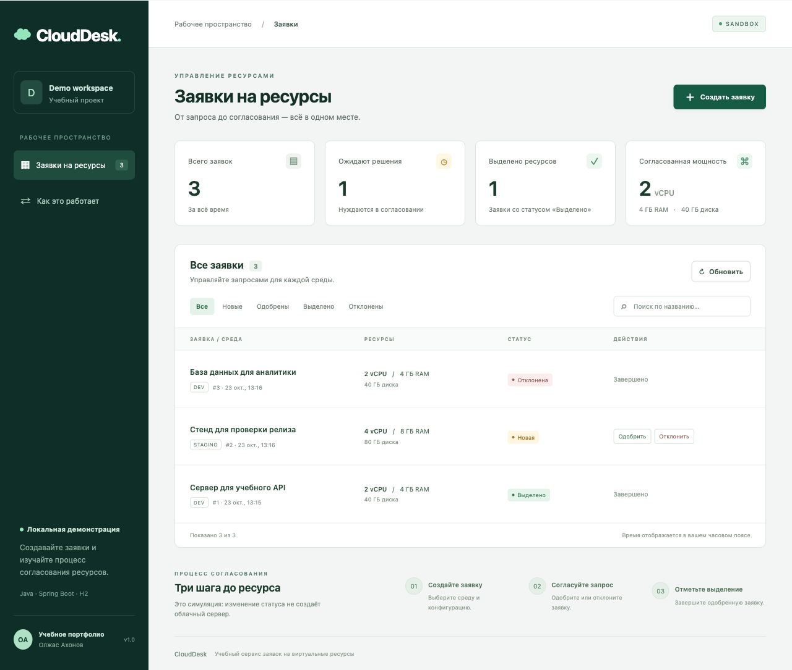

# CloudDesk

**Учебный сервис заявок на виртуальные ресурсы.** Пользователь описывает задачу и выбирает CPU, память и диск. Оператор принимает решение, а панель показывает состояние заявок и суммарные согласованные ресурсы.

Это локальный pet-проект для изучения Java/Spring и связи REST API с веб-интерфейсом. Статус «Ресурсы выделены» меняется вручную: приложение **не создаёт виртуальные машины** и не подключено к облачному провайдеру.



Впервые разбираетесь с пет-проектом? Начните с [простого руководства и подготовки к интервью](docs/LEARNING_GUIDE_RU.md): путь запроса по файлам, объяснение терминов и три самостоятельных упражнения.

## Возможности

- Создание заявки: название, описание, окружение, vCPU, RAM и диск.
- Список заявок от новых к старым, фильтр по статусу, просмотр отдельной заявки через API.
- Проверка числовых границ, обязательных полей и структуры JSON на сервере.
- Контролируемый жизненный цикл и понятные сообщения об ошибках.
- Сводка количества заявок и ресурсов для согласованных/выделенных заявок.
- Хранение данных между запусками в файловой H2; отдельная H2 в памяти для тестов.
- Опциональный профиль PostgreSQL.

## Стек

Java 17+, Spring Boot 3.5.16, Spring Web, Spring Data JPA, Bean Validation, H2, PostgreSQL JDBC, Maven Wrapper 3.3.4 / Maven 3.9.11, JUnit 5 и MockMvc. Клиент — обычные HTML, CSS и JavaScript: Node.js и отдельная сборка не нужны.

Код компилируется с Java release 17. Spring Boot 3.5 поддерживает Java 17–25 ([официальные требования](https://docs.spring.io/spring-boot/3.5/system-requirements.html)). Maven Wrapper скачан из официальной поставки Apache; SHA-256 дистрибутива Maven закреплён в настройках ([документация Wrapper](https://maven.apache.org/tools/wrapper/)).

## Быстрый запуск

Нужен установленный **JDK 17–25** и интернет при первой сборке. Устанавливать Maven отдельно не требуется.

```bash
java -version
./mvnw spring-boot:run
```

В Windows используйте `mvnw.cmd spring-boot:run`.

Откройте **http://127.0.0.1:8080**. Первый старт может занять несколько минут из-за загрузки зависимостей. Остановка — `Ctrl+C` в терминале. Запускайте команды из корня проекта.

Приложение привязано к `127.0.0.1` и доступно только на вашем компьютере. Порт можно изменить:

```bash
./mvnw spring-boot:run -Dspring-boot.run.arguments=--server.port=8081
```

База создаётся в `data/clouddesk.mv.db`. Папка `data/` исключена из Git. Для чистой демонстрации сначала остановите приложение и **переименуйте** эту папку, сохранив прежние данные. Начальных заявок нет — создайте свою через форму.

### Сборка JAR

```bash
./mvnw clean verify
java -jar target/clouddesk-1.0.0.jar
```

## Как устроена логика

```text
NEW ──→ APPROVED ──→ PROVISIONED
 │
 └────→ REJECTED
```

`NEW` — новая заявка; `APPROVED` — согласована; `PROVISIONED` — ресурсы условно выделены; `REJECTED` — отклонена. Возврат назад, повтор того же перехода и изменение конечного статуса возвращают **409 Conflict**. Статусы — часть доменной логики, они проверяются на сервере даже при прямом вызове API.

Суммы `totalCpu`, `totalMemoryGb`, `totalStorageGb` включают только `APPROVED` и `PROVISIONED`; новые и отклонённые заявки не занимают условные ресурсы. Одобрение заявки не проверяет реальную доступную ёмкость — это следующая возможная задача проекта.

## Архитектура

```text
Браузер (static/index.html, CSS, JavaScript)
    ↓ HTTP/JSON
RequestController        маршруты и валидация входных DTO
    ↓
RequestService           транзакции, поиск, сводка
    ↓
ResourceRequest          допустимые переходы статусов
    ↓
RequestRepository        Spring Data JPA
    ↓
H2 / PostgreSQL          сохранённые заявки
```

- `request/CreateRequest`, `UpdateStatus` — входные DTO с ограничениями Bean Validation.
- `RequestView` — контракт ответа, отдельный от JPA entity; внутренний `version` не раскрывается.
- `RequestStatus` — явная матрица переходов.
- `ResourceRequest` — сущность с идентификатором, датами и `@Version` для оптимистической блокировки.
- `RequestService` — операции выполняются в транзакциях. Два параллельных изменения одной версии не могут молча перезаписать друг друга.
- `api/ApiExceptionHandler` — единый формат ожидаемых ошибок.
- `src/test` — проверки реального Spring-контекста, HTTP-контроллеров и базы H2 без подмены репозитория.

Для небольшого учебного объёма сводка считается проходом по заявкам. При росте данных нужны SQL-агрегации и пагинация.

## REST API

Все пути относительны к `http://127.0.0.1:8080`; тела запросов — `application/json`.

| Метод | Путь | Результат |
|---|---|---|
| GET | `/api/requests` | Массив заявок, сначала новые |
| GET | `/api/requests?status=NEW` | Фильтр по `NEW`, `APPROVED`, `REJECTED`, `PROVISIONED` |
| GET | `/api/requests/{id}` | Одна заявка или 404 |
| POST | `/api/requests` | Создание, 201 и заголовок `Location` |
| PATCH | `/api/requests/{id}/status` | Изменение статуса, 200 или 409 |
| GET | `/api/stats` | Количества и ресурсные суммы |

Удаление и редактирование содержания заявки не реализованы: текущий сценарий сохраняет исходные условия и решение по ним.

### Создать заявку

```bash
curl -i http://127.0.0.1:8080/api/requests \
  -H 'Content-Type: application/json' \
  -d '{"title":"API для учебного проекта","description":"Тестовый сервер Java-приложения","environment":"DEVELOPMENT","cpu":2,"memoryGb":4,"storageGb":40}'
```

Ограничения: `title` — 1–120 символов, `description` — 1–2000, оба не пустые; `environment` — `DEVELOPMENT`, `STAGING` или `PRODUCTION`; `cpu` — целое 1–32; `memoryGb` — целое 1–128; `storageGb` — целое 10–2000. Все поля обязательны. Пробелы по краям текстовых полей удаляются. Неизвестные JSON-поля отклоняются.

Пример ответа (ID и даты будут вашими):

```json
{
  "id": 1,
  "title": "API для учебного проекта",
  "description": "Тестовый сервер Java-приложения",
  "environment": "DEVELOPMENT",
  "cpu": 2,
  "memoryGb": 4,
  "storageGb": 40,
  "status": "NEW",
  "createdAt": "2026-10-23T10:00:00Z",
  "updatedAt": "2026-10-23T10:00:00Z"
}
```

Даты передаются в формате ISO 8601, UTC. Подставьте ID из ответа в следующих командах:

```bash
curl http://127.0.0.1:8080/api/requests/1

curl -X PATCH http://127.0.0.1:8080/api/requests/1/status \
  -H 'Content-Type: application/json' -d '{"status":"APPROVED"}'

curl -X PATCH http://127.0.0.1:8080/api/requests/1/status \
  -H 'Content-Type: application/json' -d '{"status":"PROVISIONED"}'

curl 'http://127.0.0.1:8080/api/requests?status=PROVISIONED'
curl http://127.0.0.1:8080/api/stats
```

Для одного такого запроса сводка после двух переходов:

```json
{"total":1,"pending":0,"approved":0,"provisioned":1,"rejected":0,"totalCpu":2,"totalMemoryGb":4,"totalStorageGb":40}
```

### Ошибки

```json
{
  "status": 400,
  "message": "Проверьте поля заявки",
  "fieldErrors": {"cpu": "Минимум 1 vCPU"}
}
```

- `400` — неверные поля, JSON, enum, параметры URL или отсутствующее тело.
- `404` — заявка или маршрут не найдены.
- `409` — запрещённый переход либо конфликт параллельного изменения.
- `405` — метод не поддерживается.
- `415` — неверный `Content-Type`.

`fieldErrors` всегда объект; он пуст, если ошибка не связана с отдельным полем.

## Проверки

```bash
./mvnw test
```

Набор проверяет жизненный цикл, все 16 сочетаний статусов, невозможность повторного/обратного перехода, сортировку и фильтрацию, сводку без двойного учёта, валидацию и ошибки HTTP. Отдельная проверка показывает, что устаревшая копия сущности не перезапишет сохранённое решение благодаря `@Version`.

Тестовый профиль использует H2 в памяти и не изменяет пользовательскую файловую базу. GitHub Actions запускает `verify` на Java 17 при push/PR; сам workflow проверится после публикации репозитория.

## PostgreSQL — опционально

Быстрый старт работает без Docker и PostgreSQL. Если PostgreSQL уже установлен, создайте пустую базу `clouddesk` и отдельного пользователя с правами на неё. Затем задайте переменные окружения в текущем терминале:

```bash
export DB_URL='jdbc:postgresql://localhost:5432/clouddesk'
export DB_USER='clouddesk'
export DB_PASSWORD='your-local-password'
./mvnw spring-boot:run -Dspring-boot.run.profiles=postgres
```

Используйте свой пароль; не сохраняйте его в Git. Файл `.env` автоматически не читается. База H2 не мигрирует в PostgreSQL: это отдельное хранилище. Профиль предоставлен как конфигурация; основной прогон тестов выполняется на H2.

## Что рассказать на демонстрации

1. Создайте заявку и покажите её начальный статус.
2. Одобрите её: увеличатся суммы ресурсов, новая заявка исчезнет из фильтра `NEW`.
3. Отметьте условное выделение ресурсов: суммы не удвоятся.
4. Создайте и отклоните вторую заявку: она останется в истории без резервирования ресурсов.
5. Отправьте запрещённый переход через `curl` и объясните, зачем нужен 409.
6. Покажите `RequestStatus` и один интеграционный тест, затем объясните путь запроса от HTTP до БД.

## Границы проекта и развитие

Здесь нет пользователей, авторизации, ролевой модели, журнала действий, реального provisioning, лимитов организации, расчёта стоимости и пагинации. Человек с доступом к приложению может менять все заявки. Это демонстрация на локальной машине; перед общим доступом нужны аутентификация, права, защита запросов и аудит. Схема развивается через `ddl-auto=update` для удобства обучения; для production нужны миграции Flyway/Liquibase.

Последовательные следующие задачи: добавить пагинацию и SQL-сводку; внедрить роли заявитель/оператор; добавить историю переходов и миграции; покрыть PostgreSQL интеграционными тестами; после этого подключать тестовый облачный API.

Проект подготовлен с помощью AI-инструментов. Перед включением в портфолио разберите код, выполните сценарий демонстрации и внесите собственное изменение, которое сможете объяснить.
